# **PROJECT**
### **Hosting a Static Website on AWS (S3 + CloudFront)**

Deployed a free HTML/CSS/JS template (Lustro Slideshow) as a fully functional static website using Amazon S3 and Amazon CloudFront

# **STEPS I FOLLOWED**

Downloaded and extracted the static website template.

Created a private Amazon S3 bucket and uploaded all website files to the root of the bucket.

Created a CloudFront distribution and set the S3 bucket as the origin.

Configured Origin Access Control (OAC) so only CloudFront can access the S3 bucket.

Set the Default Root Object to index.html.

Set Viewer Protocol Policy to Redirect HTTP to HTTPS.

Applied the CloudFront-generated bucket policy to the S3 bucket.

Waited for the distribution to deploy and tested the live website.

# Result

The website is now live and served securely over HTTPS through CloudFront’s global CDN

## Creating A Private S3 Bucket For Static Website Hosting

Created a new Amazon S3 bucket with the following settings:

Bucket type: General purpose

Bucket name: 
NEWCLODYSTATICWEBSITEDEPLOYMENTPROJECT

Then the rest were mostly recommended or picked by default and left unchanged

### Go To AMAZON S3 To Create A New Bucket In AWS Click on Create Bucket To Create A New Bucket

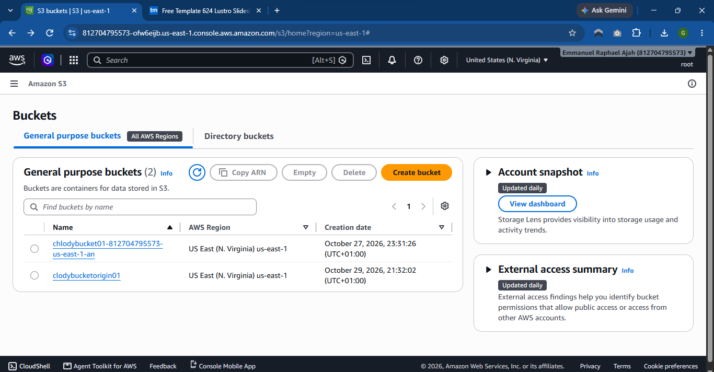
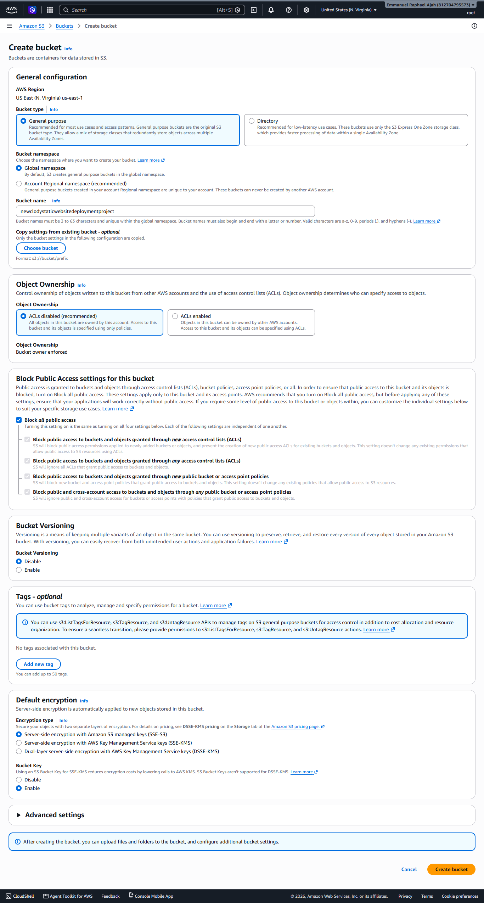

# BUCKET SUCCESSFULLY CREATED
click on UPLOAD to upload your extracted static website template

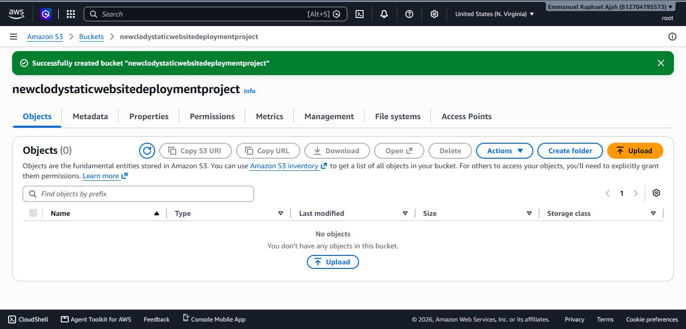

**Click On Add Files To Upload Your Extracted Template Files:** Select all The Files Then Click On Open to upload them in your bucket
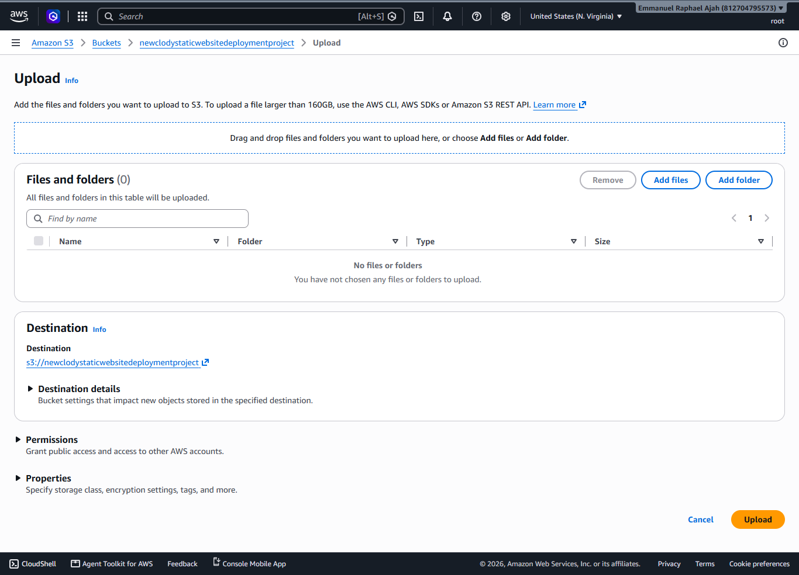
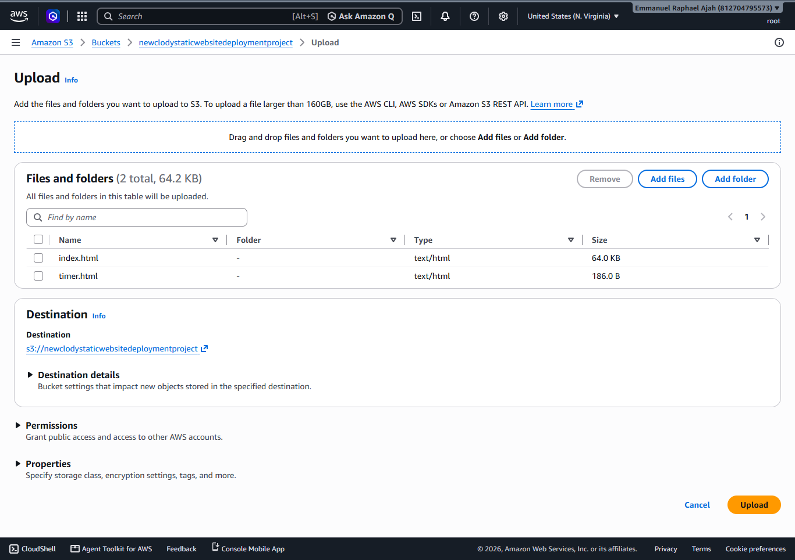

## Files Successfully Uploaded To My Bucket
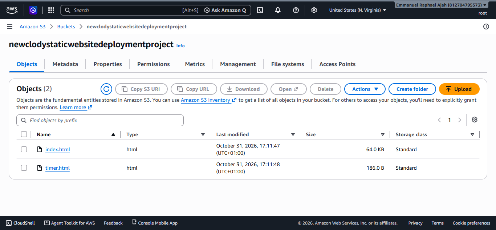
-

Next: i Created A Cloudfront Distribution
Set The S3 Bucket As The Origin

Go To Cloudfront Click On Distribution Then Click On **CREATE DISTRIBUTION**

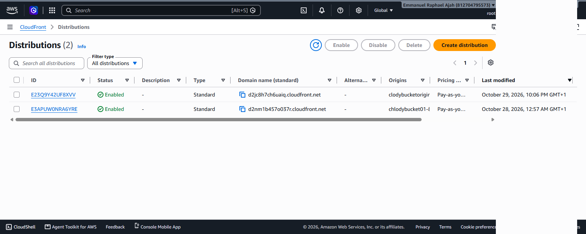
-

click on **CREATE DISTRIBUTION:**

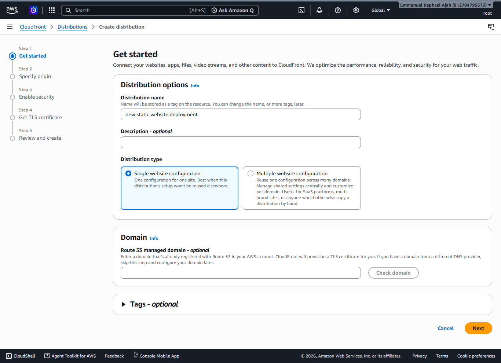

choose the bucket you created as your bucket of origin

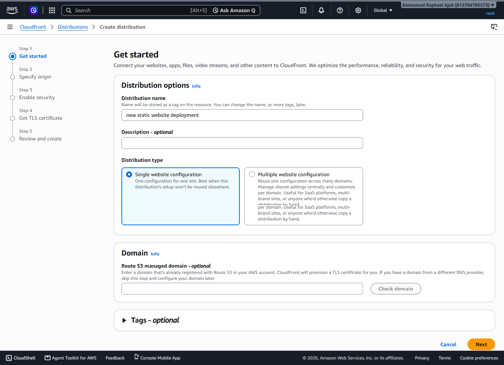
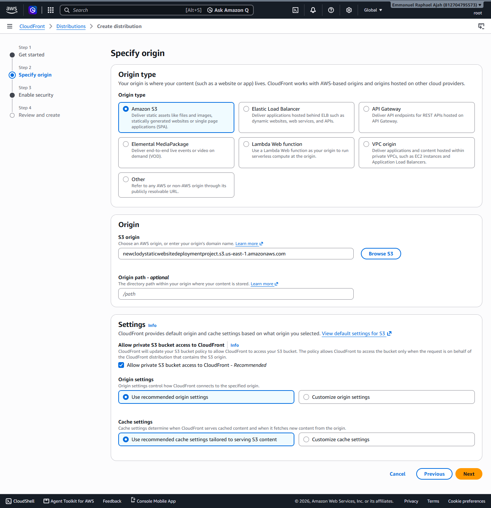
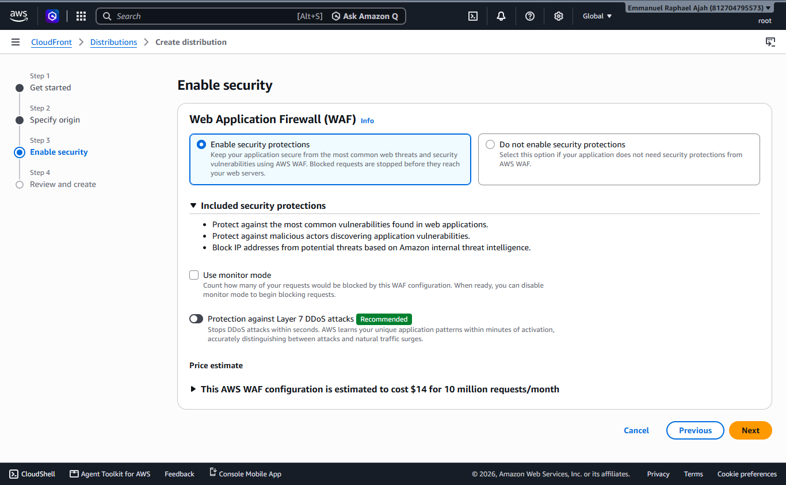

click on CREATE DISTRIBUTION
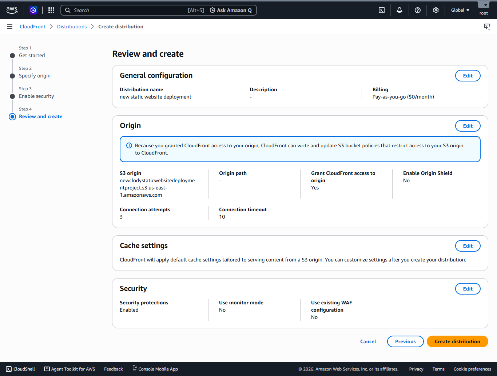

## Cloudfront Distribution Successfully Created
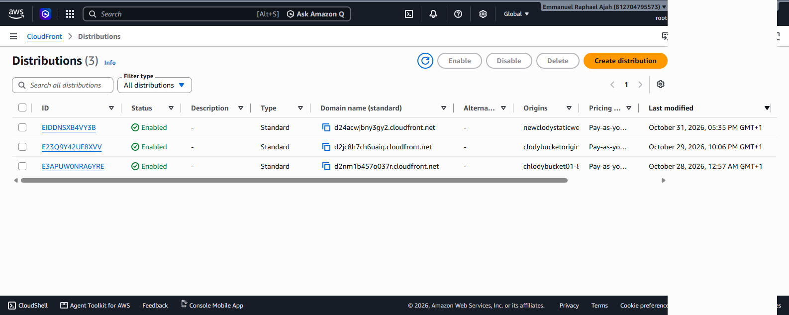

# copy the domain name and paste into your browser:

## SITE IS FULLY ACTIVE

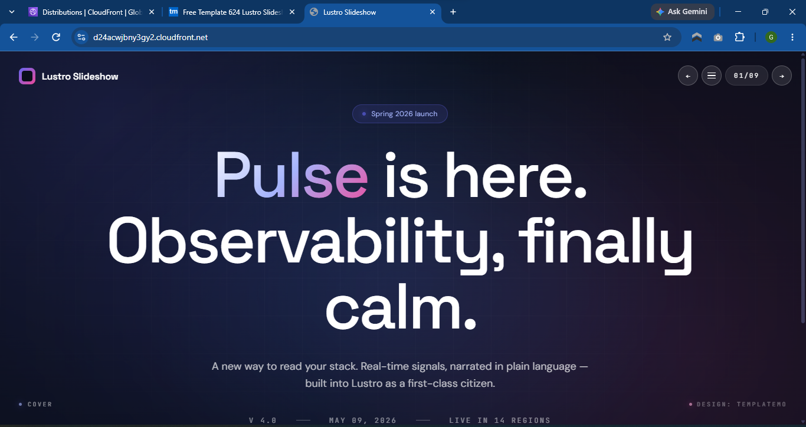
-

- follow on [LinkedIN](https://www.linkedin.com/in/emmanuel-raphael-908442442) and on [X](https://x.com/cubycue)